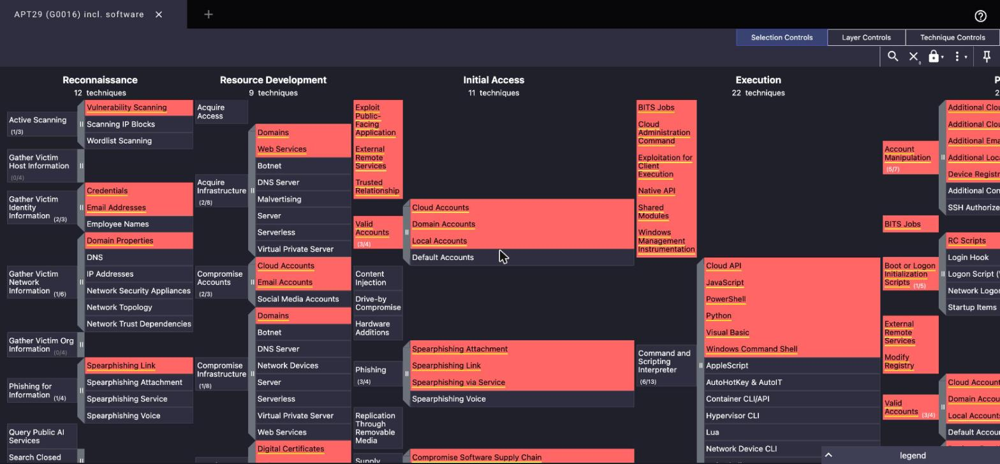
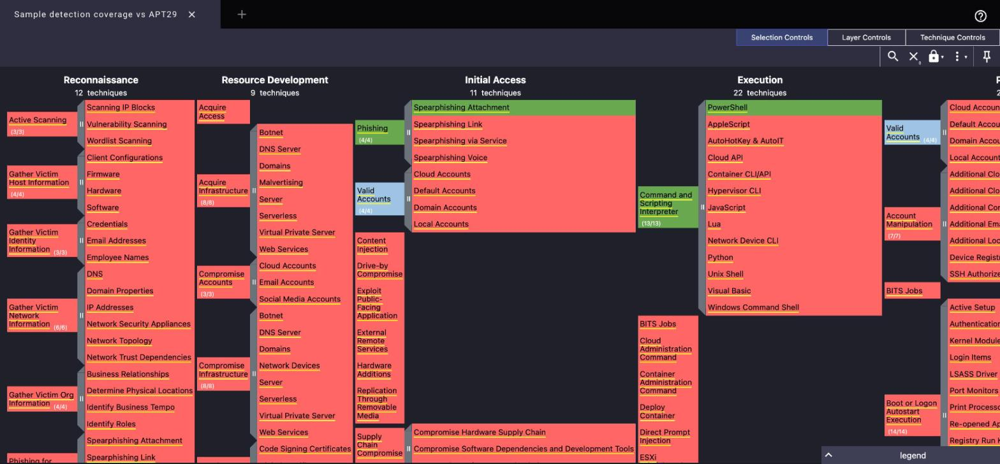
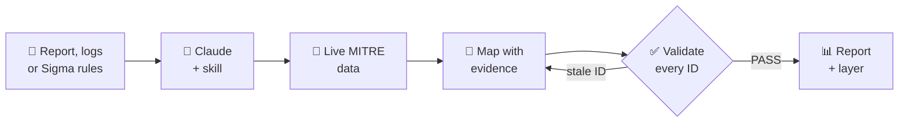

<div align="center">



<br>

[](https://attack.mitre.org/resources/updates/)
[](#-quick-start)
[](tools/attack.py)
[](https://mitre-attack.github.io/attack-navigator/)
[](LICENSE)
[](https://github.com/THARAGESHWARAN-SATHYAMOORTHY/mitre-attack-skill/stargazers)

**Turn Claude into an ATT&CK analyst that never quotes a technique ID from memory.**

Map incidents, measure detection coverage, build Navigator layers and plan emulations,<br>
with every ID checked against MITRE's live data before you see it.

[Quick start](#-quick-start) · [See it work](#-see-it-work) · [What you can ask](#-what-you-can-ask) · [How it works](#%EF%B8%8F-how-it-works) · [CLI](#-the-cli-works-without-claude-too) · [FAQ](#-faq)

</div>

---

## 🚨 The problem: your model's ATT&CK is out of date

ATT&CK changes twice a year, and the big 2026 releases broke a lot of mappings people write from memory:

- **v19 (April 2026)** split _Defense Evasion_ into **Stealth** (TA0005) and a new **Defense Impairment** tactic (TA0112), revoked 17 techniques and added 23.
- **v20 (October 2026)** added AI techniques such as **T1698 Indirect Prompt Injection** and **T1700 AI-Enabled Exfiltration**.

So `T1562.001 Disable or Modify Tools` and `T1070.001 Clear Windows Event Logs`, two of the most-cited IDs in detection engineering, **no longer exist**. Ask a model for a mapping and you'll still get them.

This skill fixes that. Claude runs a small CLI against MITRE's official STIX data, and **checks every ID before the answer reaches you**:

```text
$ attack validate incident-notes.md

- result: FAIL - fix before publishing
- Legacy 'Defense Evasion' on line 1: since v19 Enterprise TA0005 is Stealth and
  breaking defenses is TA0112 Defense Impairment.

| id        | status  | name                     | action                                         |
|-----------|---------|--------------------------|------------------------------------------------|
| T1070.001 | REVOKED | Clear Windows Event Logs | replace with T1685.005 [defense-impairment]    |
| T1562.001 | REVOKED | Disable or Modify Tools  | replace with T1685 [defense-impairment]        |
| T1672     | REVOKED | Email Spoofing           | replace with T1684.002 [stealth]               |
| T9999     | UNKNOWN |                          | not in ATT&CK enterprise v20.1; fix or remove  |
```

<sub>Real output from <code>tools/attack.py</code> against ATT&CK Enterprise v20.1, trimmed to fit.</sub>

---

## ⚡ Quick start

### Claude Code (30 seconds)

```bash
/plugin marketplace add THARAGESHWARAN-SATHYAMOORTHY/mitre-attack-skill
```

```bash
/plugin install mitre-attack@mitre-attack-skill
```

Then just ask: _"Map this incident report to ATT&CK"_. The skill loads itself whenever ATT&CK comes up.

<details>
<summary><b>Claude.ai / Claude Desktop</b></summary>

1. Download this repo (**Code → Download ZIP**) and unzip it.
2. Zip the `skills/mitre-attack` folder on its own.
3. In Claude, open **Settings → Capabilities → Skills**, upload the zip and switch it on.

The skill needs code execution with network access to `raw.githubusercontent.com` to download ATT&CK data.

</details>

<details>
<summary><b>Claude Agent SDK, or one project only</b></summary>

Copy `skills/mitre-attack/` into your project's `.claude/skills/` folder.

</details>

**Requirements:** Python 3.8+. No API keys, no `pip install`, no third-party packages.

---

## 🎬 See it work

<table>
<tr>
<td width="50%" valign="top">

**You ask**

> Who is Cozy Bear and what do they use? Give me a Navigator layer.

**Claude**

Resolves the alias to **G0016 APT29**, pulls its techniques (including those of its software), and writes a layer you can open straight away:

<a href="https://mitre-attack.github.io/attack-navigator/#layerURL=https%3A%2F%2Fraw.githubusercontent.com%2FTHARAGESHWARAN-SATHYAMOORTHY%2Fmitre-attack-skill%2Fmain%2Fexamples%2Fapt29-layer.json"></a>



</td>
<td width="50%" valign="top">

**You ask**

> Here are our detections. Where are we blind against APT29?

**Claude**

Scores each technique (none / logs / rule / tested), reports coverage per tactic, and ranks the gaps by how often the group uses them:

<a href="https://mitre-attack.github.io/attack-navigator/#layerURL=https%3A%2F%2Fraw.githubusercontent.com%2FTHARAGESHWARAN-SATHYAMOORTHY%2Fmitre-attack-skill%2Fmain%2Fexamples%2Fcoverage-layer.json"></a>



</td>
</tr>
</table>

<details>
<summary><b>Sample coverage report</b> (from <a href="examples/detections.csv"><code>examples/detections.csv</code></a>)</summary>

```text
$ attack coverage examples/detections.csv --groups APT29 --top 5

| tactic             | id     | techniques | logs+ | rule+ | tested | coverage_% |
|--------------------|--------|------------|-------|-------|--------|------------|
| ...                |        |            |       |       |        |            |
| Initial Access     | TA0001 | 22         | 3     | 3     | 2      | 13.6       |
| Execution          | TA0002 | 66         | 2     | 2     | 2      | 3.0        |
| ...                |        |            |       |       |        |            |
| Defense Impairment | TA0112 | 57         | 1     | 1     | 0      | 1.8        |
| Credential Access  | TA0006 | 68         | 4     | 2     | 0      | 2.9        |
| ...                |        |            |       |       |        |            |
| Lateral Movement   | TA0008 | 23         | 2     | 0     | 0      | 0.0        |
| ...                |        |            |       |       |        |            |

top gaps (ranked by APT29 use)
| id        | name                                      | status | campaigns | DET     |
|-----------|-------------------------------------------|--------|-----------|---------|
| T1105     | Ingress Tool Transfer                     | none   | 30        | DET0060 |
| T1588.002 | Obtain Capabilities: Tool                 | none   | 27        | DET0852 |
| T1190     | Exploit Public-Facing Application         | none   | 22        | DET0080 |
| T1071.001 | Application Layer Protocol: Web Protocols | none   | 21        | DET0027 |
| T1059.003 | Command and Scripting Interpreter: Windows Command Shell | none | 18 | DET0202 |
```

Each gap links to its **detection strategy** (DET → analytics → data components), so you know which log source to collect next.

</details>

---

## 💬 What you can ask

| Job                    | Try asking                                                      | You get                                                                                                             |
| ---------------------- | --------------------------------------------------------------- | ------------------------------------------------------------------------------------------------------------------- |
| **Incident mapping**   | _"Map this incident report to ATT&CK"_                          | A table of behaviours, each with redacted evidence, tactic, technique, sub-technique and confidence, validated PASS |
| **Threat modelling**   | _"Threat model our web app with ATT&CK"_                        | Techniques that apply to your architecture, ranked, with the controls you have and the gaps                         |
| **Detection coverage** | _"Where are our coverage gaps?"_ (attach a CSV or Sigma folder) | Per-tactic coverage %, gaps ranked by real-world use, and a Navigator layer                                         |
| **Sigma hygiene**      | _"Check the ATT&CK tags in these Sigma rules"_                  | Revoked, legacy and mismatched tags, then a coverage report                                                         |
| **Actor profiling**    | _"What does FIN7 do? Compare it with APT29"_                    | Techniques, software and campaigns, plus union, overlap or difference layers                                        |
| **Emulation planning** | _"Build an emulation plan for APT29 on Windows"_                | Ordered steps with Atomic Red Team test GUIDs, expected telemetry and expected detections                           |
| **Version migration**  | _"Update our 2024 mappings to the current ATT&CK"_              | Revoked IDs replaced, Defense Evasion split into Stealth and Defense Impairment                                     |
| **Quick lookups**      | _"Is T1086 still valid?"_, _"What's T0886?"_                    | Status, replacement chain, tactics, platforms, detections, and who uses it                                          |

Covers all three domains: **Enterprise**, **Mobile** and **ICS**.

---

## ⚙️ How it works



1. **Live data, not memory.** The skill installs `attack.py` and downloads the official bundles from [`mitre-attack/attack-stix-data`](https://github.com/mitre-attack/attack-stix-data). Every deliverable states the ATT&CK version it was checked against.
2. **Evidence or nothing.** Every mapping cites a quote, log line or page. Inferences are marked low-confidence with the reason.
3. **Validated before you see it.** Claude runs `attack validate` on its own draft and fixes every finding first.

### Guardrails built in

|                              |                                                                                                                      |
| ---------------------------- | -------------------------------------------------------------------------------------------------------------------- |
| 🔍 **No invented IDs**       | Every technique, group and software ID is looked up, not recalled                                                    |
| 🧾 **No invented behaviour** | No evidence, no mapping                                                                                              |
| 🔒 **Redaction**             | Secrets, tokens, credential hashes and PII are stripped from logs before they reach a table, layer comment or report |
| 🛡️ **No weaponisation**      | Atomic Red Team output is test names and GUIDs only. No exploit code, payloads or attack commands                    |
| 🎯 **Most specific match**   | Uses the sub-technique the evidence supports, otherwise the parent                                                   |

---

## 🐍 The CLI works without Claude too

[`tools/attack.py`](tools/attack.py) is a single-file, standard-library-only ATT&CK CLI. Use it in scripts and CI:

```bash
curl -O https://raw.githubusercontent.com/THARAGESHWARAN-SATHYAMOORTHY/mitre-attack-skill/main/tools/attack.py
python3 -I attack.py update
python3 -I attack.py get T1562
```

| Command                           | What it does                                                                                                                                                         |
| --------------------------------- | -------------------------------------------------------------------------------------------------------------------------------------------------------------------- |
| `update` / `version` / `stats`    | Download or refresh the bundles, show the data version, count objects                                                                                                |
| `get <ID or name>`                | Full detail for any object: tactics, platforms, sub-techniques, mitigations, detection strategies with log sources, who uses it, revoked status with its replacement |
| `search "<text>"`                 | Ranked search over names, aliases and descriptions (`"Cozy Bear"` → `G0016 APT29`)                                                                                   |
| `group` / `software` / `campaign` | Profile with techniques, software, campaigns and attribution                                                                                                         |
| `validate <file>`                 | Check every ID in text, CSV, JSON or Sigma YAML. `--fix` writes a corrected copy                                                                                     |
| `layer`                           | Navigator 4.5 layer from a technique list, or from groups with `union` / `intersection` / `diff`                                                                     |
| `coverage <csv>`                  | Per-tactic coverage, gaps ranked by how many groups use each technique, plus a layer                                                                                 |
| `sigma <dir>`                     | Read `attack.tXXXX` tags from Sigma rules, flag tag problems, report coverage                                                                                        |
| `diff <old> <new>`                | What changed between releases, e.g. `enterprise@19.1 enterprise@20.1`                                                                                                |
| `atomic <technique>`              | Atomic Red Team test names, platforms and GUIDs (no commands)                                                                                                        |

<details>
<summary><b>Use <code>validate</code> as a CI gate</b></summary>

`validate` exits with code **1** when it finds a revoked, unknown or legacy ID, so it can fail a pull request that adds stale mappings:

```yaml
# .github/workflows/attack-ids.yml
name: ATT&CK IDs
on: [pull_request]
jobs:
  validate:
    runs-on: ubuntu-latest
    steps:
      - uses: actions/checkout@v4
      - run: curl -sSO https://raw.githubusercontent.com/THARAGESHWARAN-SATHYAMOORTHY/mitre-attack-skill/main/tools/attack.py
      - run: python3 -I attack.py update -d enterprise
      - name: Validate every mapping file
        run: |
          status=0
          for f in $(git ls-files 'detections/*.csv' 'rules/*.yml' 'reports/*.md'); do
            python3 -I attack.py validate "$f" -d enterprise || status=1
          done
          exit $status
```

For a real pipeline, pin `attack.py` to a commit rather than `main`.

</details>

---

## 🆚 Compared with asking a model directly

|                                                 |   Plain prompting    | **This skill** |
| ----------------------------------------------- | :------------------: | :------------: |
| Knows v19's Stealth / Defense Impairment split  |     ❌ often not     |       ✅       |
| Knows v20's AI techniques (T1698, T1699, T1700) |     ❌ often not     |       ✅       |
| Catches revoked IDs and gives the replacement   |          ❌          |       ✅       |
| States the ATT&CK version of every answer       |          ❌          |       ✅       |
| Detection strategies → analytics → log sources  |    ⚠️ from memory    |  ✅ from data  |
| Navigator layers that open first time           | ⚠️ hand-written JSON | ✅ format 4.5  |
| Evidence and confidence per mapping             |    ⚠️ if you ask     |   ✅ always    |
| Redacts secrets and PII from pasted logs        |          ❌          |       ✅       |

---

## ❓ FAQ

<details>
<summary><b>Does it need an API key or a paid service?</b></summary>

No. The data comes from MITRE's public GitHub repository, and the tool uses only the Python standard library.

</details>

<details>
<summary><b>What happens when MITRE releases a new version?</b></summary>

`attack.py update` pulls the latest data (it refreshes anything older than 24 hours), and the skill trusts live data over its own text. Mappings stay correct even before the skill's notes are updated. Use `attack diff enterprise@20.1 enterprise@<new>` to see exactly what changed.

</details>

<details>
<summary><b>Can I pin an older release for an audit?</b></summary>

Yes: `attack update --release 19.1` saves that exact release, and `diff` compares any two.

</details>

<details>
<summary><b>Is my data sent anywhere?</b></summary>

The tool only downloads ATT&CK data from GitHub. Your reports and logs stay in your Claude conversation, and the skill redacts secrets and PII before anything goes into its output.

</details>

<details>
<summary><b>Does it cover MITRE ATLAS (attacks on AI systems)?</b></summary>

Not yet. It covers ATT&CK's AI-related techniques (v20) and points you to ATLAS for attacks on AI systems themselves. ATLAS support is on the roadmap.

</details>

---

## 🗺️ Roadmap

- [ ] MITRE ATLAS lookups alongside ATT&CK
- [ ] D3FEND countermeasure suggestions for each gap
- [ ] Caldera ability mapping for emulation plans
- [ ] Ready-made GitHub Action for `validate`

Have an idea? [Open an issue](https://github.com/THARAGESHWARAN-SATHYAMOORTHY/mitre-attack-skill/issues).

## 🤝 Contributing

Contributions are welcome, especially new workflows, output templates and fixes after a new ATT&CK release. See [CONTRIBUTING.md](CONTRIBUTING.md).

If this saved you from shipping a revoked technique ID, **a ⭐ helps other defenders find it.**

[](https://star-history.com/#THARAGESHWARAN-SATHYAMOORTHY/mitre-attack-skill&Date)

## 📜 Licence and attribution

The skill and `attack.py` are released under the [MIT licence](LICENSE). Third-party attribution is in [NOTICE](NOTICE).

MITRE ATT&CK® and ATT&CK® are registered trademarks of The MITRE Corporation. ATT&CK content is © The MITRE Corporation and is used under the [ATT&CK Terms of Use](https://attack.mitre.org/resources/legal-and-branding/terms-of-use/). This project is independent and is not affiliated with or endorsed by MITRE.
